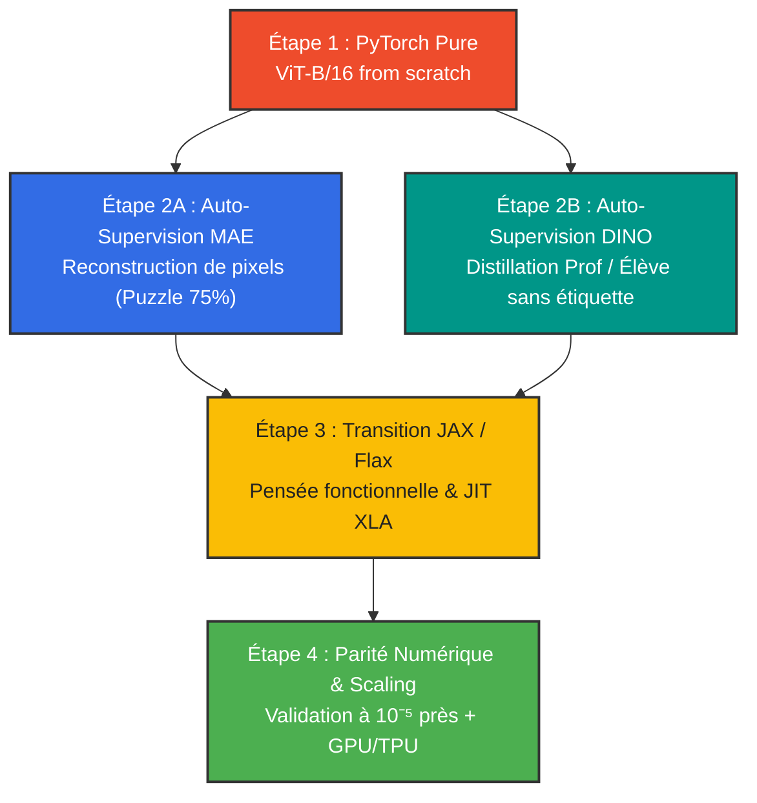
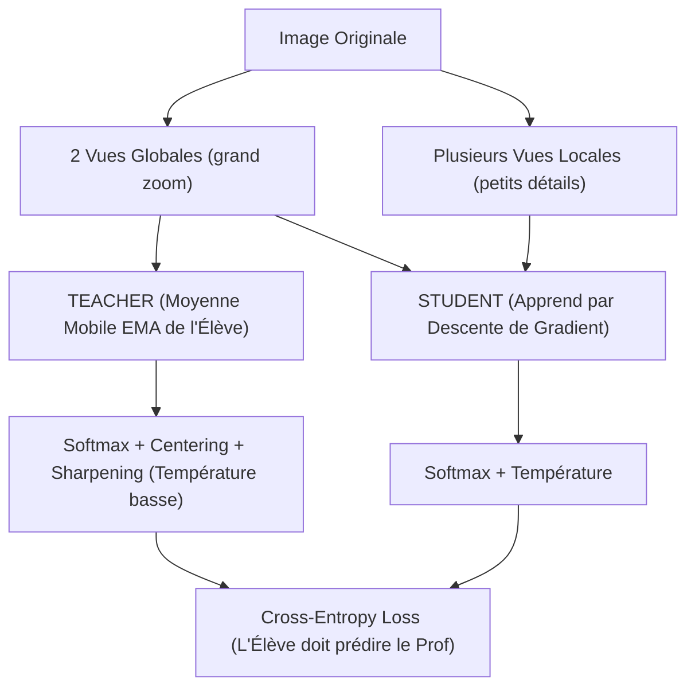

# 👁️ ViT-JAX : Du Zéro au Héro en Vision Transformers & Auto-Supervision

> **Un voyage d'apprentissage complet, pas à pas :** Comprendre et coder un **Vision Transformer (ViT-B/16)** de zéro en **PyTorch**, implémenter les deux algorithmes majeurs d'auto-supervision (**MAE** & **DINO**), puis effectuer la transition moderne vers **JAX / Flax**.

---

## 🧭 Sommaire

- [📖 Le Dico Simple (Démystifier le Jargon)](#-le-dico-simple-démystifier-le-jargon)
- [📚 Fiches Théoriques & Notes Pas-à-Pas](#-fiches-théoriques--notes-pas-à-pas)
- [📄 Bibliothèque des Papiers Fondateurs (PDFs)](#-bibliothèque-des-papiers-fondateurs-pdfs)
- [🗺️ Vue d'Ensemble & Feuille de Route](#️-vue-densemble--feuille-de-route)
- [🧱 Phase 1 : ViT-B/16 from Scratch en PyTorch](#-phase-1--vit-b16-from-scratch-en-pytorch)
- [🧩 Phase 2A : Auto-Supervision par MAE (Le Puzzle Visuel)](#-phase-2a--auto-supervision-par-mae-le-puzzle-visuel)
- [🧑‍🏫 Phase 2B : Auto-Supervision par DINO (Professeur & Élève)](#-phase-2b--auto-supervision-par-dino-professeur--élève)
- [⚡ Phase 3 : La Grande Bascule vers JAX & Flax](#-phase-3--la-grande-bascule-vers-jax--flax)
- [🛠️ Boîte à Outils Recommandée](#️-boîte-à-outils-recommandée)
- [✅ La Checklist Maîtresse (Pas à Pas)](#-la-checklist-maîtresse-pas-à-pas)
- [📂 Structure Suggérée du Dépôt](#-structure-suggérée-du-dépôt)

---

## 📖 Le Dico Simple (Démystifier le Jargon)

Avant de taper une seule ligne de code, voici la traduction en français clair des termes qui font peur :

| Terme | Définition Simple | Analogie du Monde Réel |
| :--- | :--- | :--- |
| **Vision Transformer (ViT)** | Un modèle d'IA créé à l'origine pour le texte (comme ChatGPT) adapté pour comprendre des images entières. | Au lieu de regarder une photo pixel par pixel avec une loupe (comme un CNN), le ViT lit la photo comme une bande dessinée découpée en vignettes. |
| **Patch (ex. 16×16)** | Un petit carré découpé dans l'image (16 pixels de large sur 16 pixels de haut). Une image $224 \times 224$ donne $14 \times 14 = 196$ patches. | C'est l'équivalent d'un **mot** dans une phrase. |
| **ViT-B/16** | **B** = "Base" (taille moyenne du modèle : 86 millions de paramètres, 12 couches, dimension 768). **16** = côté du patch en pixels. | C'est le "standard d'or" de la recherche, ni trop petit pour être inutile, ni trop gigantesque pour bloquer votre machine. |
| **CLS Token** | Un jeton spécial (un vecteur neutre factice) ajouté au tout début de la séquence de patches. | Le chef d'orchestre : il observe tous les patches et à la fin, c'est lui qui donne le verdict final (*"c'est un chat"*). |
| **Positional Encoding** | Une information mathématique ajoutée à chaque patch pour indiquer **où** il se trouve dans l'image. | Sans lui, si vous mélangez toutes les pièces d'un puzzle dans un sac, le Transformer ne saurait pas laquelle était en haut à gauche ou en bas à droite. |
| **Auto-supervision (SSL)** | Entraîner une IA **sans aucune étiquette humaine** (pas de labels "chat", "chien", "voiture"). Le modèle apprend la structure du monde par lui-même. | Comment un bébé apprend la gravité et les formes en manipulant des objets, sans qu'un professeur ne lui mette une note à chaque seconde. |
| **MAE (Masked Autoencoder)** | Méthode d'auto-supervision où l'on cache 75% des morceaux d'une photo et où le modèle doit peindre ce qui manque. | Le jeu des trous dans un texte à trous, mais pour les pixels. |
| **DINO (Self-Distillation)** | Méthode d'auto-supervision où deux versions du modèle (un prof et un élève) regardent différents zooms d'une photo et doivent être d'accord sur le sens global. | Deux détectives qui regardent des indices différents mais doivent tomber sur la même conclusion. |
| **JAX** | Une bibliothèque créée par Google qui permet d'exécuter du code Python ultra-rapide sur GPU/TPU grâce à la compilation automatique (`XLA`). | C'est comme du NumPy, mais qui roule en Formule 1 et calcule les dérivées tout seul. |
| **Flax** | La surcouche de réseaux de neurones pour JAX (l'équivalent de `torch.nn` pour PyTorch). | La boîte à outils pour empiler des couches de neurones dans le monde JAX. |

---

## 📚 Fiches Théoriques & Notes Pas-à-Pas

Ces fiches détaillent les calculs matriciels, la disposition mémoire et les subtilités mathématiques abordées au fil du projet :

- 📖 [**Fiche 01 : Patch Embedding, Positional Encoding & Rééchantillonnage 2D (Bicubique)**](./notes/01_patch_embedding_et_positional_encoding.md)
  *Du découpage en patchs $16 \times 16$ à l'arithmétique exacte des paramètres, la gestion de la mémoire Row-Major (`flatten(2).transpose(1, 2)`), le rôle du `[CLS]` token (197 tokens), et la technique d'interpolation bicubique pour résolutions dynamiques.*

---

## 📄 Bibliothèque des Papiers Fondateurs (PDFs)

Tous les articles de recherche fondateurs sont archivés en PDF dans le dossier [`papiers/`](./papiers/) :

| Article | Auteurs & Année | Rôle dans ViT-JAX | Lien PDF |
| :--- | :--- | :--- | :--- |
| **Attention Is All You Need** | Vaswani et al. *(2017)* | Architecture Transformer d'origine & Self-Attention | [📄 `papiers/attention.pdf`](./papiers/attention.pdf) |
| **Vision Transformer (ViT)** | Dosovitskiy et al. *(2020)* | Découpage en patchs $16\times16$ et application à la vision | [📄 `papiers/vit.pdf`](./papiers/vit.pdf) |
| **DeiT** | Touvron et al. *(2020)* | Entraînement efficace sans données massives (Distillation) | [📄 `papiers/deit.pdf`](./papiers/deit.pdf) |
| **DINO** | Caron et al. *(2021)* | Auto-supervision sans étiquette (Student / Teacher EMA) | [📄 `papiers/dino.pdf`](./papiers/dino.pdf) |
| **MAE** | Kaiming He et al. *(2021)* | Auto-supervision par reconstruction de puzzle (75% masqué) | [📄 `papiers/mae.pdf`](./papiers/mae.pdf) |
| **DINOv2** | Oquab et al. *(2023)* | Extension à grande échelle & représentations universelles | [📄 `papiers/dinov2.pdf`](./papiers/dinov2.pdf) |

---

## 🗺️ Vue d'Ensemble & Feuille de Route



---

## 🧱 Phase 1 : ViT-B/16 from Scratch en PyTorch

### 1.1 Anatomie d'un ViT-B/16

Une image standard fait $224 \times 224$ pixels avec 3 canaux (Rouge, Vert, Bleu).
1. On la découpe en morceaux de $16 \times 16$ pixels $\implies (224/16) \times (224/16) = 14 \times 14 = 196$ patches.
2. Chaque patch a $16 \times 16 \times 3 = 768$ valeurs de pixels.
3. On projette chaque patch dans un espace vectoriel de dimension $D = 768$. C'est le **Patch Embedding** !

```mermaid
graph LR
    Img["Image (3, 224, 224)"] --> Patches["196 Patches (768 pixels chacun)"]
    Patches --> Linear["Projection Linéaire (Conv2d 16x16, stride 16)"]
    Linear --> Tokens["196 Patch Tokens (196, 768)"]
    Tokens --> AddCLS["Ajout du [CLS] Token -> (197, 768)"]
    AddCLS --> AddPos["Ajout du Positional Encoding (+ Pos)"]
    AddPos --> Transformer["12 Blocs Transformer Encoder"]
    Transformer --> Out["Représentation Finale"]
```



### 1.2 Les 4 Briques Fondamentales à Coder

1. **`PatchEmbedding` :**
   - Implémenté élégamment avec `nn.Conv2d(in_channels=3, out_channels=768, kernel_size=16, stride=16)`.
   - On aplatit ensuite la dimension spatiale : `(B, 768, 14, 14)` $\to$ `(B, 196, 768)`.
2. **`PositionalEmbedding` & `CLS Token` :**
   - Le `cls_token` est un paramètre apprenable de taille `(1, 1, 768)`.
   - Le `pos_embed` est un paramètre apprenable de taille `(1, 197, 768)`.
   - On concatène le CLS token aux 196 patches, puis on ajoute (`+`) l'encodage de position.
3. **`MultiHeadSelfAttention (MHSA)` :**
   - 12 têtes d'attention (`num_heads = 12`).
   - Chaque tête travaille sur une sous-dimension $d_k = 768 / 12 = 64$.
   - Formule classique :
     $$\text{Attention}(Q, K, V) = \text{softmax}\left(\frac{Q K^T}{\sqrt{d_k}}\right) V$$
4. **`TransformerBlock` & `MLP` :**
   - Norme avant les opérations (**Pre-LayerNorm**) : plus stable à l'entraînement que Post-LN.
   - MLP : Deux couches linéaires avec expansion $4\times$ ($768 \to 3072 \to 768$) et activation GELU.
   - Connexions résiduelles (`x = x + self.attn(self.norm1(x))`).

---

## 🧩 Phase 2A : Auto-Supervision par MAE (Le Puzzle Visuel)

*Référence : Kaiming He et al., "Masked Autoencoders Are Scalable Vision Learners" (CVPR 2022)* · [📄 PDF dans le repo](./papiers/mae.pdf) · [arXiv:2111.06377](https://arxiv.org/abs/2111.06377)


### 💡 Pourquoi MAE est une idée géniale ?
1. **Une image a trop de redondance :** Dans le texte (BERT), on ne masque que 15% des mots car les mots ont une forte densité sémantique. Dans une image, si vous masquez seulement 15%, le modèle triche en copiant les pixels voisins. En masquant **75%**, il est forcé de comprendre ce qu'est un œil, une roue ou une aile pour la reconstituer !
2. **L'Asymétrie Encodeur / Décodeur :** L'encodeur (qui est le gros modèle ViT-B) ne traite que les **25% de patches visibles** (49 patches au lieu de 196). Le calcul de l'attention dépend du carré du nombre de patches : $49^2 \approx 2401$ contre $196^2 \approx 38416$. L'entraînement est donc **$4\times$ plus rapide et consomme $4\times$ moins de mémoire** !

---

## 🧑‍🏫 Phase 2B : Auto-Supervision par DINO (Professeur & Élève)

*Référence : Mathilde Caron et al., "Emerging Properties in Self-Supervised Vision Transformers" (ICCV 2021)* · [📄 PDF dans le repo](./papiers/dino.pdf) · [arXiv:2104.14294](https://arxiv.org/abs/2104.14294)



### 💡 Le secret de DINO : Pourquoi ça ne s'effondre pas ?
Si vous demandez à deux réseaux de produire la même chose sans labels, ils risquent de trouver une solution triviale : sortir un vecteur constant (ex: toujours des zéros). C'est le **collapsus**.
DINO résout ce problème avec deux astuces simples :
1. **Centering (Centrage) :** On soustrait une moyenne mobile des sorties du professeur pour éviter qu'une dimension ne prenne le dessus.
2. **Sharpening (Aiguisage) :** On utilise une température très basse $\tau_t$ sur le professeur pour forcer ses probabilités à avoir des pics nets.

**Magie visuelle :** À la fin de l'entraînement DINO, si vous affichez l'attention du `CLS token`, le modèle a appris tout seul à segmenter les objets au pixel près sans jamais avoir vu une seule étiquette !

---

## ⚡ Phase 3 : La Grande Bascule vers JAX & Flax

### 🧠 Le Changement de Philosophie : De PyTorch à JAX

| Concept | PyTorch | JAX / Flax |
| :--- | :--- | :--- |
| **Paradigme** | Orienté Objet (les couches stockent leurs poids en interne). | Fonctionnel Pur (les fonctions ne modifient rien, elles prennent des paramètres en entrée et retournent de nouvelles valeurs). |
| **Les Poids** | `self.weight` dans le module. | Un dictionnaire immuable (PyTree) : `variables['params']`. |
| **Génération Aléatoire** | Globale avec état caché (`torch.randn`). | Explicite avec des clés PRNG (`rng, key = jax.random.split(rng)`). |
| **Compilation** | Eager par défaut (exécution ligne par ligne). | Compilation JIT XLA (`@jax.jit`) qui fusionne les calculs pour une vitesse fulgurante. |
| **Optimiseur** | `optimizer.step()` modifie les poids en place. | `Optax` : fonction pure `updates, new_opt_state = opt.update(grads, opt_state)`. |

### 🎯 Le Test de Parité Numérique (Le Juge de Paix)
La meilleure manière d'apprendre JAX sans faire d'erreurs :
1. Sauvegarder les poids de ton ViT PyTorch (`model.state_dict()`).
2. Écrire le script de conversion qui charge ces poids dans un dictionnaire Flax.
3. Passer la même image dans le modèle PyTorch et le modèle Flax.
4. **Tester :** `np.testing.assert_allclose(torch_output, jax_output, atol=1e-5)`. Si ça passe, ton code JAX est 100% mathématiquement identique !

---

## 🛠️ Boîte à Outils Recommandée

### 1. Visualisation & Suivi des Expériences
- **Choix par défaut : `matplotlib` en local :**
  - Zéro compte à créer, zéro connexion internet requise.
  - Sauvegarde automatique de planches d'images dans `outputs/` :
    - Pour MAE : un triptyque `Originale | Masquée (75%) | Reconstituée`.
    - Pour DINO : les cartes de chaleur d'attention superposées à la photo.
- **Optionnel (si tu veux des courbes web) : `Weights & Biases (WandB)` :**
  - Ultra-simple à brancher (`wandb.log({"loss": loss})`), idéal pour comparer tes runs.

### 2. Données pour Débuter sans Surchauffer
Entraîner ViT-B/16 sur tout ImageNet-1K (1,2 million d'images) demande des clusters de serveurs. Pour apprendre et itérer sur ta machine :
- **CIFAR-100 (32×32) / TinyImageNet (64×64) :** Téléchargement instantané, parfait pour valider que ton code tourne et que les pertes diminuent.
- **ImageNette (sous-ensemble de 10 classes d'ImageNet en 224×224) :** La vraie résolution de ViT-B/16, mais sur quelques gigaoctets seulement.

### 3. Les Librairies Python Essentielles

```bash
# L'environnement PyTorch & Vision
pip install torch torchvision timm matplotlib tqdm einops

# L'environnement JAX & Flax
pip install jax jaxlib flax optax
```

---

## ✅ La Checklist Maîtresse (Pas à Pas)

Coche chaque case au fur et à mesure de ta progression !

### 🟢 Étape 1 : ViT-B/16 en PyTorch
- [ ] **1.1** Créer la classe `PatchEmbedding` avec `nn.Conv2d` et vérifier la taille de sortie `(B, 196, 768)`.
- [ ] **1.2** Implémenter l'ajout du `[CLS]` token et du `pos_embed` apprenable.
- [ ] **1.3** Coder la couche `MultiHeadSelfAttention` avec projection $Q, K, V$ et softmax d'attention.
- [ ] **1.4** Coder le bloc `MLP` avec deux couches linéaires et activation GELU.
- [ ] **1.5** Assembler le `TransformerEncoderBlock` avec connexions résiduelles et Pre-LayerNorm.
- [ ] **1.6** Empiler 12 blocs pour former le modèle `VisionTransformerB16`.
- [ ] **1.7** Écrire un test unitaire qui passe un tenseur aléatoire `torch.randn(2, 3, 224, 224)` et vérifie la dimension de sortie.
- [ ] **1.8** Entraîner sur 5 époques de CIFAR-100 en classification supervisée pour voir le modèle converger.

### 🟡 Étape 2A : Auto-Supervision MAE (Masked Autoencoder)
- [ ] **2.1** Implémenter la fonction de masquage aléatoire : garder seulement 25% des patches non masqués.
- [ ] **2.2** Configurer l'encodeur ViT pour qu'il ne traite que les patches visibles.
- [ ] **2.3** Coder le décodeur léger (4 blocs Transformer, dimension 512).
- [ ] **2.4** Insérer les tokens de masque apprenables (`[MASK]`) pour reformer la grille complète de 196 positions.
- [ ] **2.5** Projeter la sortie du décodeur vers les pixels ($16 \times 16 \times 3 = 768$) avec normalisation des patches.
- [ ] **2.6** Calculer la perte MSE uniquement sur les patches masqués.
- [ ] **2.7** Écrire un script `visualize_mae.py` avec Matplotlib pour afficher côte à côte : *Image originale*, *Image masquée* et *Image reconstruite*.

### 🔵 Étape 2B : Auto-Supervision DINO
- [ ] **2.8** Créer la pipeline de transformation Multi-Crop (2 vues globales $224\times224$ + 6 vues locales $96\times96$).
- [ ] **2.9** Instancier le modèle Élève (Student) et le modèle Professeur (Teacher) avec la même architecture ViT.
- [ ] **2.10** Coder la mise à jour par moyenne mobile exponentielle (EMA) des poids du Teacher : $\theta_t \leftarrow \lambda \theta_t + (1 - \lambda) \theta_s$.
- [ ] **2.11** Implémenter la tête de projection DINO (MLP 3 couches + normalisation $L_2$).
- [ ] **2.12** Implémenter le Centering et le Sharpening avec température sur les sorties du Teacher.
- [ ] **2.13** Coder la fonction de perte Cross-Entropy entre Student et Teacher.
- [ ] **2.14** Écrire un script `visualize_attention.py` pour extraire et tracer les cartes d'attention du `CLS token` sur des images de test.

### 🟣 Étape 3 : La Bascule vers JAX / Flax
- [ ] **3.1** Installer JAX et Flax sur ton environnement.
- [ ] **3.2** Écrire un premier bloc d'attention simple avec `flax.linen.Module`.
- [ ] **3.3** Réécrire `VisionTransformer` complet en Flax.
- [ ] **3.4** Écrire le script de conversion de poids (`weights_converter.py`) pour copier les tenseurs PyTorch dans l'arbre de paramètres Flax.
- [ ] **3.5** Exécuter le test de parité numérique : vérifier que `torch_out` et `flax_out` sont identiques à $10^{-5}$ près !
- [ ] **3.6** Coder la boucle d'entraînement fonctionnelle avec `@jax.jit` et l'optimiseur `optax.adamw`.
- [ ] **3.7** Mesurer le gain de vitesse et l'utilisation de la mémoire entre PyTorch et JAX compilé.

---

## 📂 Structure Suggérée du Dépôt

Voici l'organisation recommandée pour ranger ton code proprement :

```text
ViT-jax/
├── README.md                 # Ce guide maître avec la checklist
├── requirements.txt          # Dépendances Python (torch, jax, flax, etc.)
│
├── notes/                    # Fiches théoriques & Démonstrations pas-à-pas
│   └── 01_patch_embedding_et_positional_encoding.md
│
├── papiers/                  # Bibliothèque des 6 publications fondatrices (PDFs)
│   ├── attention.pdf         # Vaswani et al. (NeurIPS 2017)
│   ├── vit.pdf               # Dosovitskiy et al. (ICLR 2021)
│   ├── deit.pdf              # Touvron et al. (ICML 2021)
│   ├── dino.pdf              # Caron et al. (ICCV 2021)
│   ├── mae.pdf               # He et al. (CVPR 2022)
│   ├── dinov2.pdf            # Oquab et al. (2023)
│   └── README.md             # Index détaillé des publications
│
├── pytorch/                  # Partie 1 & 2 : Implémentations PyTorch
│   ├── models/
│   │   ├── __init__.py
│   │   ├── patch_embed.py    # Découpage et projection des patches
│   │   ├── attention.py      # Multi-Head Self-Attention
│   │   └── vit.py            # Assemblage complet du ViT-B/16
│   ├── ssl/
│   │   ├── mae.py            # Modèle et masquage MAE
│   │   └── dino.py           # Student/Teacher et pertes DINO
│   ├── train_supervised.py   # Entraînement classique (classification)
│   ├── train_mae.py          # Boucle de pré-entraînement MAE
│   └── train_dino.py         # Boucle de pré-entraînement DINO
│
├── jax/                      # Partie 3 : Port vers JAX / Flax
│   ├── models/
│   │   ├── __init__.py
│   │   └── vit_flax.py       # ViT-B/16 en Flax Linen
│   ├── convert_weights.py    # Pont PyTorch -> Flax PyTree
│   └── train_flax.py         # Entraînement fonctionnel accéléré JIT
│
├── utils/
│   ├── datasets.py           # Téléchargement et chargement des données
│   └── visualization.py      # Tracés Matplotlib (MAE puzzle & DINO attention)
│
└── outputs/                  # Images et courbes générées automatiquement
```

---

*Projet initié par Eliott Rouvier — Exploration de l'état de l'art en Vision Transformers et Auto-supervision.*
