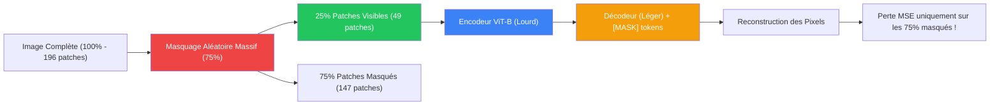
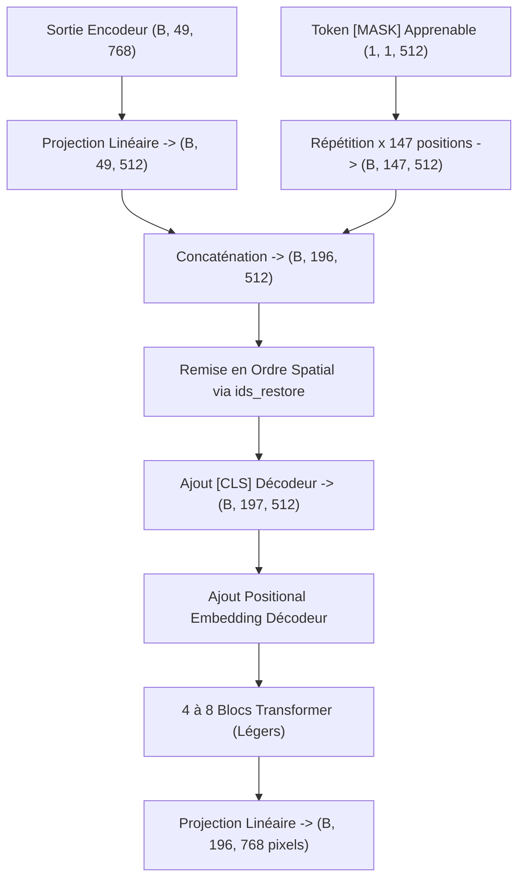

# 🧩 Fiche 02 : Auto-Supervision par MAE (Masked Autoencoders)

> **Référence :** Kaiming He, Xinlei Chen, Saining Xie, Yanghao Li, Piotr Dollár, Ross Girshick.  
> *"Masked Autoencoders Are Scalable Vision Learners"*, CVPR 2022.  
> 📄 [PDF archivé dans le projet](../papiers/mae.pdf) · [arXiv:2111.06377](https://arxiv.org/abs/2111.06377)

---

## 🧭 Sommaire

1. [Le Grand Défi : Pourquoi la Vision n'est pas le Texte](#1-le-grand-défi--pourquoi-la-vision-nest-pas-le-texte)
2. [L'Asymétrie Révolutionnaire de MAE](#2-lasymétrie-révolutionnaire-de-mae)
3. [Algorithme de Masquage : Le Tour de Magie `argsort`](#3-algorithme-de-masquage--le-tour-de-magie-argsort)
4. [L'Encodeur : Traiter 25% des Données](#4-lencodeur--traiter-25-des-données)
5. [Le Décodeur Léger : Les Tokens `[MASK]`](#5-le-décodeur-léger--les-tokens-mask)
6. [Calcul de la Perte : MSE & Normalisation des Patchs](#6-calcul-de-la-perte--mse--normalisation-des-patchs)
7. [Bilan Mathématique des Dimensions](#7-bilan-mathématique-des-dimensions)

---

## 1. Le Grand Défi : Pourquoi la Vision n'est pas le Texte

Dans le traitement du langage naturel (NLP), les modèles comme **BERT** ou **GPT** ont révolutionné l'IA grâce au masquage de mots :
- Dans une phrase, masquer **15%** des mots crée une énigme difficile (*"Le chat a sauté sur le [MASK]"* requiert de comprendre la grammaire, la syntaxe et le contexte).
- Les mots sont discrets et hautement denses en information sémantique.

### Pourquoi le masquage classique échoue sur les images :
1. **Forte redondance spatiale :** Si vous masquez un pixel ou même un petit groupe de pixels, les pixels immédiatement voisins contiennent pratiquement la même couleur et la même intensité. Le modèle n'apprend rien d'abstrait ; il interpole simplement de manière triviale.
2. **Signal continu & basse sémantique :** Une image est un ensemble continu de nombres de 0 à 255. Un pixel isolé n'a aucun sens sémantique propre.

### La Découverte de Kaiming He (CVPR 2022) :
Pour forcer un réseau de neurones à comprendre les formes globales, la géométrie 3D et les concepts visuels sans aucune étiquette humaine, il faut **masquer une proportion gigantesque de l'image : 75% à 80% !**



À 75% de masquage, un humain n'aperçoit que des morceaux épars (comme un puzzle incomplet). Pour prédire le reste, le réseau est contraint d'apprendre :
- Qu'un œil et une truffe impliquent la présence d'un museau et d'oreilles.
- La texture des poils, l'orientation de la lumière, la perspective et les silhouettes d'objets.

---

## 2. L'Asymétrie Révolutionnaire de MAE

Avant MAE, les auto-encodeurs conventionnels remplaçaient les patchs masqués par un token `[MASK]` **dès l'entrée**, forçant l'encodeur à traiter les 196 tokens au complet.

MAE introduit une **asymétrie radicale** :
1. **L'Encodeur (Lourd, ViT-B/16, 12 blocs, $D=768$)** ne voit **QUE** les **25% de patchs visibles** ($N_{\text{vis}} = 49$).
   - Complexité d'attention : $O(N_{\text{vis}}^2) = 49^2 = 2\,401$.
   - Comparé à l'image complète : $196^2 = 38\,416$.
   - **Gain de calcul d'attention : $\times 16$ plus rapide !**
   - **Gain global d'entraînement : $\sim 3\times$ à $4\times$ moins de mémoire et de temps !**
2. **Le Décodeur (Léger, 4 à 8 blocs, $D_{\text{dec}}=512$)** :
   - Reçoit les 49 patchs encodés, réinsère 147 tokens `[MASK]` apprenables pour reformer les 196 positions.
   - Ne sert que pendant le pré-entraînement auto-supervisé. Une fois l'entraînement fini, **on jette le décodeur** et on conserve l'encodeur ViT pour la classification ou la segmentation !

---

## 3. Algorithme de Masquage : Le Tour de Magie `argsort`

Comment implémenter un masquage aléatoire sans boucle `for` lente en PyTorch, tout en étant capable de **remettre chaque patch exactement à sa place d'origine** à la sortie du décodeur ?

C'est l'astuce élégante du **double `argsort`** :

```python
def random_masking(x, mask_ratio=0.75):
    """
    x : (B, N, D) tenseur des patchs projetés
    """
    B, N, D = x.shape
    len_keep = int(N * (1 - mask_ratio)) # ex: 196 * 0.25 = 49

    # 1. Bruit aléatoire uniforme
    noise = torch.rand(B, N, device=x.device)

    # 2. Premier argsort : donne l'ordre aléatoire de mélange
    ids_shuffle = torch.argsort(noise, dim=1) # indices de 0 à N-1 mélangés

    # 3. Second argsort : LE SECRET POUR RESTAURER L'ORDRE INITIAL
    ids_restore = torch.argsort(ids_shuffle, dim=1)

    # 4. On ne garde que les premiers 'len_keep' patchs
    ids_keep = ids_shuffle[:, :len_keep]
    x_masked = torch.gather(x, dim=1, index=ids_keep.unsqueeze(-1).repeat(1, 1, D))

    # 5. Création du masque binaire : 0 = visible, 1 = masqué
    mask = torch.ones(B, N, device=x.device)
    mask[:, :len_keep] = 0
    # On remet le masque dans l'ordre spatial de l'image
    mask = torch.gather(mask, dim=1, index=ids_restore)

    return x_masked, mask, ids_restore
```

### Démonstration de la réciproque `argsort(argsort)` :
Considérons une séquence de 4 éléments `[A, B, C, D]`.
- Supposons un tirage de bruit : `noise = [0.8, 0.1, 0.9, 0.3]`.
- `ids_shuffle = argsort(noise) = [1, 3, 0, 2]`.  
  *(L'élément à l'indice 1 est le plus petit, puis 3, puis 0, puis 2)*.
- Ordre mélangé : `[B, D, A, C]`.
- `ids_restore = argsort(ids_shuffle) = [2, 0, 3, 1]`.
- Si on applique `ids_restore` à `[B, D, A, C]` :
  - Indice 0 prend `[B, D, A, C][2] = A`
  - Indice 1 prend `[B, D, A, C][0] = B`
  - Indice 2 prend `[B, D, A, C][3] = C`
  - Indice 3 prend `[B, D, A, C][1] = D`
  $\implies$ On retrouve exactement l'image d'origine `[A, B, C, D]` en $O(N)$ vectorisé !

---

## 4. L'Encodeur : Traiter 25% des Données

L'encodeur est notre `VisionTransformer` (ou un sous-ensemble) :
1. **Extraction des patchs :** `(B, 3, 224, 224) -> (B, 196, 768)`.
2. **Ajout de l'encodage de position :** `pos_embed[:, 1:, :]` (sans le CLS) est d'abord ajouté aux 196 patchs.
3. **Masquage aléatoire :** On filtre via `ids_keep` $\implies$ Tenseur de forme `(B, 49, 768)`.
4. **Ajout du `[CLS]` token :** Concaténation $\implies$ `(B, 50, 768)`.
5. **Passage dans les 12 blocs Transformer :** Grâce aux connexions résiduelles et au Pre-LN, chaque patch visible interagit uniquement avec les 48 autres patchs visibles et le CLS.
6. **Sortie de l'encodeur :** Tenseur latent de forme `(B, 50, 768)`.

---

## 5. Le Décodeur Léger : Les Tokens `[MASK]`

Le rôle du décodeur est de convertir les représentations latentes des 49 patchs visibles et de combler les 147 trous pour reconstruire les pixels.



1. **Projection vers la dimension du décodeur :**
   $$\text{latent} = W_{\text{dec}} \cdot x_{\text{vis}} + b_{\text{dec}} \quad \text{avec } W_{\text{dec}} \in \mathbb{R}^{512 \times 768}$$
2. **Création du token `[MASK]` :**
   Un paramètre apprenable unique $m \in \mathbb{R}^{1 \times 1 \times 512}$, dupliqué 147 fois :
   $$M = \mathbf{1}_{147} \otimes m \in \mathbb{R}^{B \times 147 \times 512}$$
3. **Concaténation & Unshuffle :**
   On assemble les 49 patchs encodés et les 147 masques, puis on applique `torch.gather(..., ids_restore)`. La grille retrouve sa topologie $14 \times 14 = 196$ complète !
4. **Passage dans le décodeur :** 4 blocs de Transformer légers suffisent amplement car l'abstraction sémantique a déjà été réalisée par l'encodeur.

---

## 6. Calcul de la Perte : MSE & Normalisation des Patchs

Le décodeur projette chaque token vers $16 \times 16 \times 3 = 768$ valeurs de pixels.

### A. La cible pixelisée (`patchify`) :
Pour comparer la prédiction aux vrais pixels de l'image, on découpe l'image d'origine $x \in \mathbb{R}^{B \times 3 \times H \times W}$ en patchs :
$$H / 16 = 14, \quad W / 16 = 14 \implies N = 196$$
Le tenseur cible $y \in \mathbb{R}^{B \times 196 \times 768}$ contient les vraies valeurs RVB de chaque patch aplati.

### B. L'Astuce Cruciale : La Normalisation des Patchs (`norm_pix_loss`)
Kaiming He et al. démontrent qu'en normalisant chaque patch individuellement (moyenne nulle et variance unitaire) avant de calculer la perte, la qualité des représentations apprises fait un bond en avant :
$$\mu_p = \frac{1}{768} \sum_{i=1}^{768} y_{p, i}, \quad \sigma_p^2 = \frac{1}{768} \sum_{i=1}^{768} (y_{p, i} - \mu_p)^2$$
$$y_p^{\text{norm}} = \frac{y_p - \mu_p}{\sqrt{\sigma_p^2 + 10^{-6}}}$$

*Pourquoi ?* Sans cette normalisation, le modèle gaspille sa capacité à prédire la luminosité moyenne globale du patch (valeur continue basse fréquence). Avec la normalisation, le modèle est forcé de se concentrer sur les **contrastes locaux, les contours, les textures et les détails géométriques**.

### C. La Perte MSE Masquée :
La perte n'est calculée **que sur les patchs qui avaient été masqués** :
$$\mathcal{L}_{\text{MAE}} = \frac{1}{\sum_p \text{mask}_p} \sum_{p=1}^{N} \text{mask}_p \cdot \frac{1}{768} \sum_{i=1}^{768} \left( \hat{y}_{p, i} - y_{p, i}^{\text{norm}} \right)^2$$

Les 25% de patchs visibles que l'encodeur a vus ne contribuent pas à la perte (le réseau les recopierait bêtement sans réfléchir).

---

## 7. Bilan Mathématique des Dimensions

| Étape | Entrée | Opération | Sortie |
| :--- | :--- | :--- | :--- |
| **Image brute** | - | Capture capteur / batch | `(B, 3, 224, 224)` |
| **Patch Embedding** | `(B, 3, 224, 224)` | Conv2D $16\times16$ + Aplatissement | `(B, 196, 768)` |
| **Random Masking (75%)**| `(B, 196, 768)` | `argsort` + `gather` (49 visibles) | `(B, 49, 768)` |
| **Encodeur ViT-B** | `(B, 50, 768)` | 12 Blocs Pre-LN Transformer | `(B, 50, 768)` |
| **Proj. Décodeur** | `(B, 49, 768)` | Couche Linéaire $768 \to 512$ | `(B, 49, 512)` |
| **Unshuffle + [MASK]** | `(B, 49, 512)` + 147 masques | `gather(ids_restore)` | `(B, 196, 512)` |
| **Décodeur** | `(B, 197, 512)` | 4 Blocs Pre-LN Transformer ($D=512$) | `(B, 197, 512)` |
| **Prédiction Pixels** | `(B, 196, 512)` | Couche Linéaire $512 \to 768$ | `(B, 196, 768)` |
| **Calcul Perte MSE** | `Pred` vs `Patchify(Img)` | MSE masquée ($\text{mask} == 1$) | Scalaire `Loss` |
