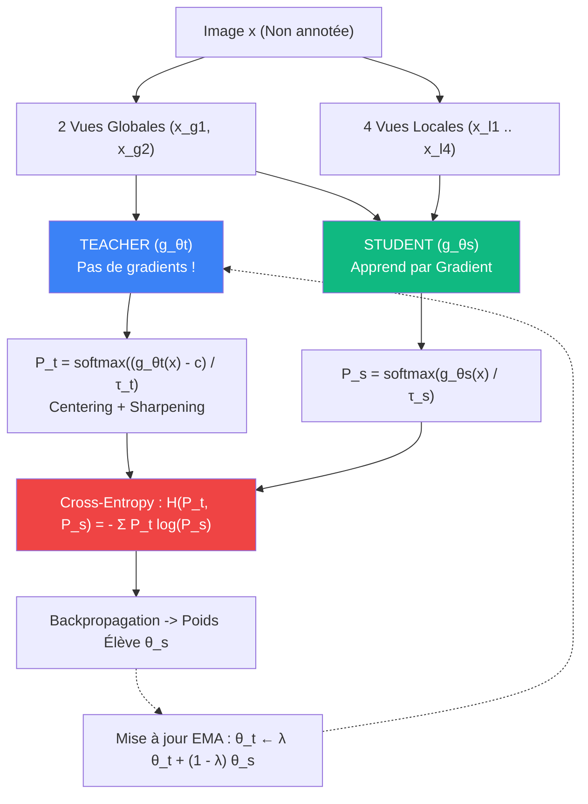

# 🧑‍🏫 Fiche 03 : Auto-Supervision par DINO (Self-Distillation)

> **Référence :** Mathilde Caron, Hugo Touvron, Ishan Misra, Hervé Jégou, Julien Mairal, Piotr Bojanowski, Armand Joulin.  
> *"Emerging Properties in Self-Supervised Vision Transformers"*, ICCV 2021.  
> 📄 [PDF archivé dans le projet](../papiers/dino.pdf) · [arXiv:2104.14294](https://arxiv.org/abs/2104.14294)

---

## 🧭 Sommaire

1. [Le Concept : L'Élève et le Professeur Sans Étiquette](#1-le-concept--lélève-et-le-professeur-sans-étiquette)
2. [L'Écueil Mortel du SSL : L'Effondrement de Représentation (Collapse)](#2-lécueil-mortel-du-ssl--leffondrement-de-représentation-collapse)
3. [L'Antidote DINO : Centering + Sharpening](#3-lantidote-dino--centering--sharpening)
4. [La Mise à Jour EMA (Exponential Moving Average)](#4-la-mise-à-jour-ema-exponential-moving-average)
5. [La Stratégie Multi-Crop : Du Local au Global](#5-la-stratégie-multi-crop--du-local-au-global)
6. [La Tête de Projection DINO & Normalisation $L_2$](#6-la-tête-de-projection-dino--normalisation-l_2)
7. [La Propriété Émergente : Segmentation Sans Supervision](#7-la-propriété-émergente--segmentation-sans-supervision)

---

## 1. Le Concept : L'Élève et le Professeur Sans Étiquette

Dans la distillation de connaissances classique, un grand modèle expert pré-entraîné (le professeur) transmet son savoir à un modèle plus compact (l'élève).

**DINO (DIstillation with NO labels)** pose une question audacieuse :
> *Peut-on faire de la distillation sans professeur pré-entraîné et sans aucune étiquette humaine ?*

L'idée fondamentale :
- On instancie deux réseaux ayant la même architecture ViT : l'**Élève** ($g_{\theta_s}$) et le **Professeur** ($g_{\theta_t}$).
- L'élève apprend par descente de gradient standard (SGD / AdamW).
- Le professeur n'a **aucun calcul de gradient** (`requires_grad = False`). Ses poids sont simplement une **moyenne mobile temporelle** (EMA) des poids successifs de l'élève.

---

## 2. L'Écueil Mortel du SSL : L'Effondrement de Représentation (Collapse)

Dans tout système auto-supervisé siamois, il existe une solution de facilité triviale pour minimiser la fonction de perte :
1. **L'effondrement constant (Dirac collapse) :** Le réseau sort exactement le même vecteur constant pour toutes les images de l'univers ($g(x) = [1, 0, 0, \dots, 0]$). La perte de similarité devient nulle, mais la représentation est totalement inutile.
2. **L'effondrement uniforme (Uniform collapse) :** Le réseau sort une distribution plate uniforme ($1/K$ partout).

---

## 3. L'Antidote DINO : Centering + Sharpening

Pour contrer mathématiquement ces deux formes d'effondrement sans recourir à des contrastive negative pairs (comme SimCLR) ou à un stop-gradient asymétrique instable (comme BYOL), DINO applique deux forces antagonistes sur les logits du Professeur :

### 1. Le Centrage (Centering) :
On maintient un vecteur de centre dynamique $c \in \mathbb{R}^K$ mis à jour par moyenne mobile :
$$c \leftarrow m \cdot c + (1 - m) \cdot \frac{1}{B} \sum_{i=1}^{B} g_{\theta_t}(x_i)$$
En soustrayant $c$ des sorties du professeur ($g_{\theta_t}(x) - c$), **aucune dimension ne peut dominer en permanence**. Cela élimine le risque d'effondrement vers un Dirac !

### 2. L'Aiguisement (Sharpening avec Température) :
La soustraction de la moyenne a cependant tendance à aplatir la distribution vers une probabilité uniforme. DINO compense cela en divisant les logits du professeur par une température très basse :
$$\tau_t \in [0.04, 0.07] \quad \text{alors que } \tau_s = 0.1$$
Comme $\tau_t < \tau_s$, le Softmax du professeur devient très "pointu" (aiguisé) et force l'élève à prendre des décisions contrastées.

$$\boxed{P_t(x) = \text{Softmax}\left( \frac{g_{\theta_t}(x) - c}{\tau_t} \right), \quad P_s(x) = \text{Softmax}\left( \frac{g_{\theta_s}(x)}{\tau_s} \right)}$$

---

## 4. La Mise à Jour EMA (Exponential Moving Average)

Les poids du Professeur $\theta_t$ ne reçoivent jamais de gradients (`requires_grad=False`). Ils suivent les poids de l'élève avec un facteur de momentum $\lambda \in [0.996, 1.0]$ :

$$\boxed{\theta_t \leftarrow \lambda \theta_t + (1 - \lambda) \theta_s}$$

- Le professeur agit comme un **Polyak-Ruppert averaging**, c'est-à-dire un ensemble temporel de tous les états passés de l'élève.
- Les prédictions du professeur sont donc nettement plus stables, douces et riches en caractéristiques sémantiques que celles de l'élève.

---

## 5. La Stratégie Multi-Crop : Du Local au Global

Une idée maîtresse de DINO pour forcer le ViT à apprendre l'invariance d'échelle :
- **2 Vues Globales** ($x_{g1}, x_{g2}$) : Grande échelle ($> 50\%$ de l'image, ex: $224 \times 224$ ou $64 \times 64$).
- **$V$ Vues Locales** ($x_{l1}, \dots, x_{lv}$) : Petite échelle ($< 50\%$ de l'image, ex: $96 \times 96$ ou $32 \times 32$), couvrant seulement un détail (une patte, un morceau de feuille).

### La Règle d'Asymétrie :
- Le **Professeur ne reçoit QUE les 2 vues globales** (il a la vision d'ensemble du contexte).
- L'**Élève reçoit TOUTES les vues** (globales et locales).
- La perte force l'élève, même lorsqu'il ne regarde qu'un minuscule détail local, à prédire la même distribution que le professeur qui a vu la scène entière :
$$\mathcal{L}_{\text{DINO}} = \sum_{x \in \{x_g\}} \sum_{\substack{x' \in \{x_g, x_l\} \\ x' \neq x}} - P_t(x) \log P_s(x')$$

---

## 6. La Tête de Projection DINO & Normalisation $L_2$

La sortie du `[CLS]` token du ViT ($D=768$) passe à travers une tête de projection MLP spécialisée :
1. **MLP à 3 couches :** $768 \to 2048 \to 2048 \to \text{Bottleneck } 256$ avec activations GELU.
2. **Normalisation $L_2$ :** Normalisation euclidienne sur la sphère unitaire du vecteur latent :
   $$z = \frac{z}{\|z\|_2}$$
3. **Couche Linéaire Prototype sans biais :** Projection vers $K$ prototypes (ex: $K=1024$ ou $4096$) normalisés en poids :
   $$g(x) = W_{\text{proto}} \cdot z \quad \text{avec } \|W_k\|_2 = 1$$
Cela mesure le cosinus de similarité entre la représentation de l'image et $K$ clusters sémantiques virtuels !

---

## 7. La Propriété Émergente : Segmentation Sans Supervision

C'est la découverte majeure de Caron et al. :  
Lorsque l'on pré-entraîne un Vision Transformer avec DINO, les têtes d'attention du `[CLS]` token dans la dernière couche se mettent spontanément à **détourer les objets de premier plan**, sans qu'aucune boîte englobante ni masque de segmentation n'ait jamais été fourni au modèle !

Chaque tête se spécialise :
- Une tête isole la silhouette générale de l'animal/objet.
- Une tête se focalise sur les yeux et la tête.
- Une tête suit les membres ou le support.
