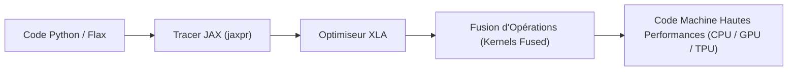

# ⚡ Notes Théoriques : Transition PyTorch vers JAX & Flax (Phase 3)

Ce document formalise les fondements théoriques, architecturaux et pratiques de la transition d'un modèle de Deep Learning orienté objet (**PyTorch**) vers un modèle fonctionnel compilé (**JAX** & **Flax**).

---

## 1. Changement de Paradigme : Orienté Objet vs Programmation Fonctionnelle Pure

### 1.1 PyTorch : L'Approche Impérative Orientée Objet (OOP)
En PyTorch, un module hérite de `torch.nn.Module`. L'état (paramètres apprenables $W, b$, buffers) et le calcul (`forward`) sont encapsulés au sein du même objet :
- Les tenseurs sont mutables in-place (`x.add_()`).
- Le graphe de calcul dynamique (*Autograd*) est reconstruit à chaque passe (`loss.backward()`).
- Le générateur de nombres pseudo-aléatoires est un état global implicite (`torch.manual_seed(42)`).

### 1.2 JAX : La Programmation Fonctionnelle Pure
JAX repose sur la transformation de **fonctions pures** :
$$\text{Sortie} = f(\text{Paramètres}, \text{Données})$$

Une fonction pure obéit à deux règles strictes :
1. **Transparence référentielle** : Pour les mêmes entrées, elle produit toujours exactement les mêmes sorties.
2. **Absence d'effets de bord** : Pas de mutation d'état global, pas de modification d'arguments en place. Les tableaux `jax.Array` sont strictement **immuables** (pour modifier un indice : `x.at[idx].set(val)`).

---

## 2. Les Piliers Fondamentaux de JAX

### 2.1 Le Générateur Aléatoire Explicite (`jax.random.PRNGKey`)
Contrairement à PyTorch ou NumPy qui maintiennent un état interne caché, JAX requiert un passage explicite de la clé aléatoire :
```python
import jax

key = jax.random.PRNGKey(42)
key, subkey1, subkey2 = jax.random.split(key, 3)

# Chaque opération consomme une sous-clé unique
noise = jax.random.normal(subkey1, shape=(2, 196, 768))
dropout_mask = jax.random.bernoulli(subkey2, p=0.1, shape=(2, 12, 197, 197))
```

### 2.2 Compilation Just-In-Time (`@jax.jit`) et XLA
JAX trace les fonctions Python une première fois avec des types et dimensions abstraits (*ShapedArray*), génère une représentation intermédiaire (*jaxpr*), puis la compile via **XLA (Accelerated Linear Algebra)**.



#### Bénéfices majeurs d'XLA pour ViT :
- **Kernel Fusion** : Fusionne les opérations séquentielles (ex: `LayerNorm` + `QKV Projection`, ou `Scale` + `Mask` + `Softmax`) en un seul kernel GPU sans allers-retours mémoire SRAM $\leftrightarrow$ HBM.
- **Élimination de l'overhead d'interpréteur Python** : Après la première compilation (warmup), l'exécution tourne à la vitesse native du matériel.

### 2.3 Les PyTrees (Arbres de Paramètres)
En JAX, les paramètres d'un réseau de neurones forment un **PyTree** (arbre imbriqué de dictionnaires, listes et tuples contenant des `jax.Array`).
Des fonctions utilitaires vectorisent les opérations sur l'ensemble de l'arbre :
```python
# Mise à jour SGD sur tous les paramètres en une ligne
new_params = jax.tree_util.tree_map(lambda p, g: p - lr * g, params, grads)
```

---

## 3. Flax Linen : L'Abstraction pour Réseaux de Neurones

Flax (`flax.linen`) concilie la syntaxe familière des couches de Deep Learning avec la pureté fonctionnelle de JAX :

```python
import flax.linen as nn

class TransformerBlockFlax(nn.Module):
    embed_dim: int
    num_heads: int
    mlp_ratio: float = 4.0

    @nn.compact
    def __call__(self, x, train: bool = False):
        norm1 = nn.LayerNorm()(x)
        attn = MultiHeadAttentionFlax(self.embed_dim, self.num_heads)(norm1)
        x = x + attn
        norm2 = nn.LayerNorm()(x)
        mlp = MLPFlax(self.embed_dim, self.mlp_ratio)(norm2)
        x = x + mlp
        return x
```

- **Séparation Modèle / Paramètres** :
  - `model = TransformerBlockFlax(...)` définit la structure déclarative.
  - `params = model.init(key, dummy_input)` initialise les poids dans un `FrozenDict`.
  - `output = model.apply(params, x)` exécute la passe avant de manière pure.

---

## 4. Stratégie de Conversion et Validation de Parité Strict à $10^{-5}$

Pour garantir que l'implémentation Flax est 100% fidèle au modèle PyTorch, nous établissons un convertisseur de poids automatique :

| Opération | PyTorch (`torch.nn`) | Flax Linen (`flax.linen`) | Règle de Transposition |
| :--- | :--- | :--- | :--- |
| **Linear** | `weight: (out_features, in_features)` | `kernel: (in_features, out_features)` | $W_{\text{flax}} = W_{\text{torch}}^T$ |
| **Linear Bias** | `bias: (out_features,)` | `bias: (out_features,)` | Identique |
| **Conv2d (PatchEmbed)** | `weight: (C_out, C_in, kH, kW)` | `kernel: (kH, kW, C_in, C_out)` | `permute(2, 3, 1, 0)` |
| **LayerNorm Scale** | `weight: (D,)` | `scale: (D,)` | Identique |
| **LayerNorm Bias** | `bias: (D,)` | `bias: (D,)` | Identique |
| **Tokens & PosEmbed** | `(1, 1, D)` et `(1, N, D)` | `(1, 1, D)` et `(1, N, D)` | Identique |

### Tolérance Numérique :
La tolérance stricte requise est :
$$\max |Y_{\text{Flax}} - Y_{\text{PyTorch}}| < 10^{-5}$$
Cette différence infinitésimale provient uniquement de l'ordre d'accumulation des multiplications flottantes FP32 entre BLAS/cuBLAS et XLA.
